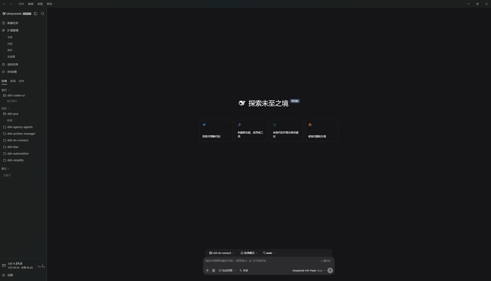
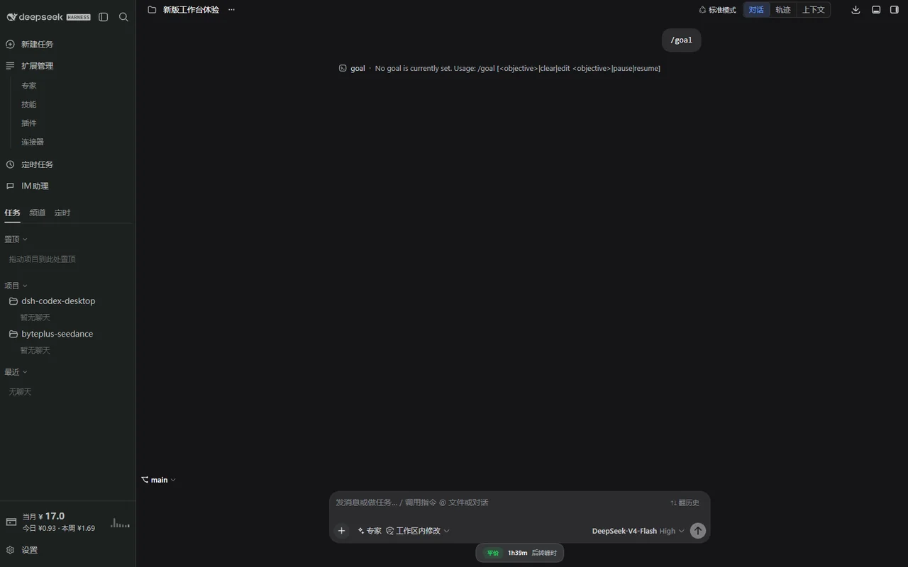

  

# DSH Codex Desktop

**Descarga una vez. Abre un espacio de trabajo de IA local listo para usar.**

[简体中文](README.zh-CN.md) · [English](README.en.md) · [日本語](README.ja.md) · [Español](README.es.md) · [Français](README.fr.md) · [Deutsch](README.de.md) · [Русский](README.ru.md) · [Português](README.pt.md)

[Descargas](https://github.com/MichengAI/dsh-codex-desktop/releases) · [Registro de cambios](CHANGELOG.md) · [Informar de un error](https://github.com/MichengAI/dsh-codex-desktop/issues)

> DSH Codex Desktop es una distribución de escritorio mantenida por la comunidad para DeepSeek Harness. No es un producto oficial de DeepSeek AI.

DSH Codex Desktop convierte [DeepSeek Harness](https://github.com/deepseek-ai/deepseek-harness) en un banco de trabajo de escritorio nativo y listo para ejecutarse. El instalador incluye el entorno Node.js y el runtime local de DSH: instálalo, ábrelo y empieza a trabajar de inmediato, sin necesidad de configurar Node.js ni iniciar DSH desde una terminal.

## Descarga e inicio

Obtén el instalador actual desde [GitHub Releases](https://github.com/MichengAI/dsh-codex-desktop/releases).

| Plataforma | Paquete | Cómo empezar |
| --- | --- | --- |
| Windows x64 | Instalador `.exe` o archivo `.zip` | Ejecuta el instalador y abre **DSH Codex Desktop** desde el menú Inicio. |
| macOS Apple Silicon / Intel | Instalador `.dmg` | Abre la imagen de disco, mueve la aplicación a Aplicaciones y ejecútala. |
| Linux x64 / ARM64 | `.AppImage` o paquete `.deb` de Debian/Ubuntu | Ejecuta el paquete correspondiente a tu arquitectura o instala el archivo deb. |

1. Descarga el paquete para tu sistema operativo.
2. Instala y abre **DSH Codex Desktop**.
3. Espera a que termine de iniciarse el servicio local de DSH.
4. Crea una tarea, selecciona el modelo y el modo de permisos, y comienza a trabajar.

La aplicación conserva los datos de DSH en tu perfil de usuario (`%USERPROFILE%\.dsh` en Windows), manteniendo tus sesiones y configuraciones tras las actualizaciones.

## Un entorno de trabajo completo

| Capacidad | Lo que obtienes |
| --- | --- |
| **Espacio de conversación** | Navegación de proyectos y tareas, sesiones de chat, selección de modelos, permisos y registros en una ventana nativa. |
| **Perfiles de expertos** | Activa especialistas para revisión de código, arquitectura, frontend, backend y operaciones. |
| **Centro de habilidades** | Revisa, activa, desactiva y gestiona habilidades locales y compartidas de Agent desde Configuración. |
| **Gestión de archivos** | Busca conversaciones archivadas, restaura sesiones o elimina registros antiguos de forma segura. |
| **Asistente de mensajería (IM)** | Configura DingTalk, Feishu, Lark, WeChat, WeCom, QQ, Telegram y más en un solo lugar. |
| **Mercado de complementos** | Descubre, instala, actualiza y diagnostica complementos de DSH sin salir de la app. |
| **Automatización programada** | Gestiona tareas periódicas desde el mismo espacio de trabajo mediante la programación de DSH. |
| **Entorno local seguro** | Inicia DSH en una dirección de loopback validada y mantiene la interfaz protegida. |

## Vista previa del producto

Explora el espacio de trabajo, la configuración en tema claro y las páginas de complementos. Haz clic en cualquier imagen para verla en resolución original.

<em>Inicio: navegación de proyectos, puntos de entrada y compositor.</em>

<em>Conversación: mensajes, trayectoria, contexto y entrada de tareas.</em>

## Complementos incluidos de fábrica

| Funcionalidad | Paquete |
| --- | --- |
| Interfaz estilo Codex | [`@michengai/dsh-codex-ui`](https://github.com/MichengAI/dsh-codex-ui) |
| Mascota de escritorio nativa y notificaciones | [`@michengai/dsh-codex-pet`](https://github.com/MichengAI/dsh-codex-pet) |
| Gestión de roles de expertos | [`@michengai/dsh-agency-agents`](https://github.com/MichengAI/dsh-agency-agents) |
| Centro de habilidades | [`@michengai/dsh-skills-manager`](https://github.com/MichengAI/dsh-skills-manager) |
| Gestión de archivos | [`@michengai/dsh-archive-manager`](https://github.com/MichengAI/dsh-archive-manager) |
| Asistente de mensajería | [`@michengai/dsh-im-connect`](https://github.com/MichengAI/dsh-im-connect) |
| Automatización programada | [`@michengai/dsh-automation`](https://github.com/MichengAI/dsh-automation) |
| Barra lateral extensible | [`dsh-better-sidebar`](https://github.com/omdsh-dev/DSH-better-sidebar) |
| Preguntas secundarias rápidas | [`@michengai/dsh-btw`](https://github.com/MichengAI/dsh-btw) |
| Simplificación de código en cambios Git | [`@michengai/dsh-simplify`](https://github.com/MichengAI/dsh-simplify) |
| Diagnóstico y reintentos ante fallos | [`@michengai/dsh-pua`](https://github.com/MichengAI/dsh-pua) |
| Revisión de código independiente | [`@michengai/dsh-code-review`](https://github.com/MichengAI/dsh-code-review) |
| Mercado de complementos | [`dshmarket`](https://www.npmjs.com/package/dshmarket) |

## Licencia

Este proyecto está distribuido bajo la licencia [Apache 2.0](LICENSE).
