<p align="center">
  
</p>

<div align="center">

# DSH Codex Desktop

**Baixe uma vez. Abra um espaço de trabalho de IA local pronto para usar.**

[简体中文](README.zh-CN.md) · [English](README.en.md) · [日本語](README.ja.md) · [Español](README.es.md) · [Français](README.fr.md) · [Deutsch](README.de.md) · [Русский](README.ru.md) · [Português](README.pt.md)

[Downloads](https://github.com/MichengAI/dsh-codex-desktop/releases) · [Registro de alterações](CHANGELOG.md) · [Relatar problema](https://github.com/MichengAI/dsh-codex-desktop/issues)

[](https://github.com/MichengAI/dsh-codex-desktop/releases)
[](LICENSE)
[](https://github.com/MichengAI/dsh-codex-desktop/actions/workflows/desktop-package.yml)


</div>

> O DSH Codex Desktop é uma distribuição de desktop mantida pela comunidade para o DeepSeek Harness. Não é um produto oficial da DeepSeek AI.

O DSH Codex Desktop transforma o [DeepSeek Harness](https://github.com/deepseek-ai/deepseek-harness) em uma estação de trabalho desktop nativa e pronta para uso. O instalador inclui o runtime Node.js necessário e o runtime local do DSH: basta instalar, abrir e começar a trabalhar sem necessidade de configurações manuais.

## Download e inicialização

Obtenha o instalador mais recente no [GitHub Releases](https://github.com/MichengAI/dsh-codex-desktop/releases).

| Plataforma | Pacote | Como começar |
| --- | --- | --- |
| Windows x64 | Instalador `.exe` ou arquivo `.zip` | Execute o instalador e abra o **DSH Codex Desktop** no menu Iniciar. |
| macOS Apple Silicon / Intel | Instalador `.dmg` | Abra a imagem de disco, mova o app para Aplicativos e execute. |
| Linux x64 / ARM64 | `.AppImage` ou pacote `.deb` para Debian/Ubuntu | Execute o AppImage para sua arquitetura ou instale o pacote deb. |

1. Baixe o pacote para seu sistema operacional.
2. Instale e abra o **DSH Codex Desktop**.
3. Aguarde o serviço local do DSH terminar de inicializar.
4. Crie uma tarefa, escolha o modelo e comece a produzir em seus projetos.

O aplicativo preserva os dados do DSH na sua pasta de perfil habitual (`%USERPROFILE%\.dsh` no Windows), mantendo suas sessões e configurações após atualizações.

## Estação de trabalho completa

| Recurso | O que você obtém |
| --- | --- |
| **Espaço de conversas** | Navegação por projetos, sessões, seleção de modelos e controle de permissões em janela nativa. |
| **Perfis de especialistas** | Ative papéis especializados para revisão de código, arquitetura, frontend, backend e operações. |
| **Central de habilidades** | Visualize, ative, desative e gerencie habilidades locais e compartilhadas de Agent nas Configurações. |
| **Gestão de arquivos** | Pesquise conversas arquivadas, restaure sessões ou exclua registros com segurança. |
| **Assistente de mensagens (IM)** | Integre canais como DingTalk, Feishu, Lark, WeChat, QQ, Telegram em um só lugar. |
| **Mercado de extensões** | Descubra, instale e atualize plugins DSH sem sair do cliente desktop. |
| **Automação agendada** | Programe tarefas recorrentes diretamente do mesmo espaço de trabalho. |
| **Ambiente local seguro** | Inicialização em endereço loopback validado com interface protegida. |

## Visão geral do produto

Explore o espaço de trabalho desktop, as configurações em tema claro e as páginas de gerenciamento de plugins. Clique em qualquer imagem para visualizá-la em resolução original.

<p align="center"><em>Início: navegação de projetos, pontos de entrada de tarefas e compositor.</em></p>

<p align="center"><a href="assets/screenshots/preview-home.webp"></a></p>

<p align="center"><em>Conversa: mensagens, trajetória, contexto e entrada de tarefas.</em></p>

<p align="center"><a href="assets/screenshots/preview-conversation.webp"></a></p>

<details>
<summary>Aparência e mascotes desktop (2 capturas)</summary>

<p align="center"><em>Configurações em tema claro: permissões, idioma, aparência e editor.</em></p>

<p align="center"><a href="assets/screenshots/preview-general-light.webp">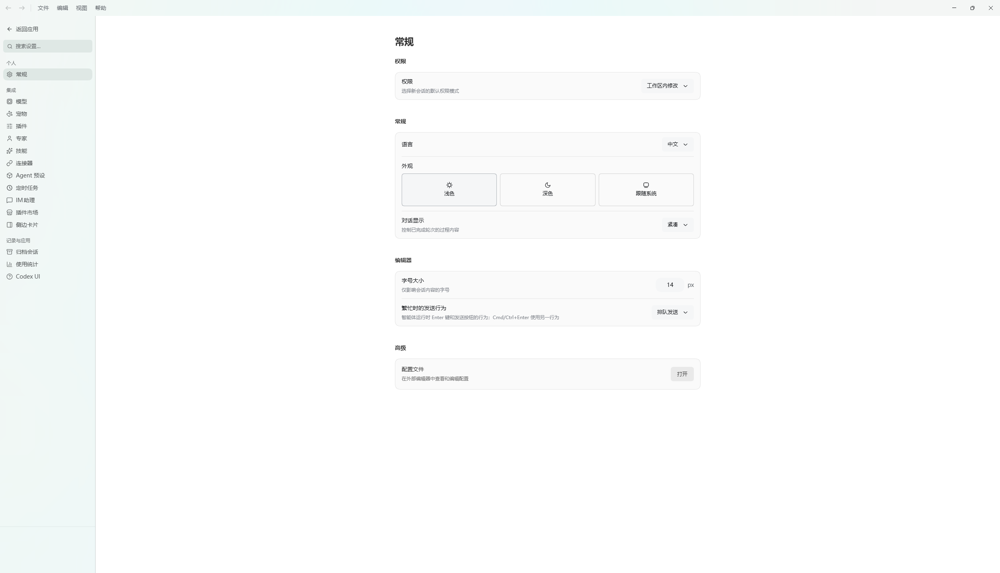</a></p>

<p align="center"><em>Configurações do mascote: escolha do companheiro, gestão e tamanho.</em></p>

<p align="center"><a href="assets/screenshots/preview-pets.webp">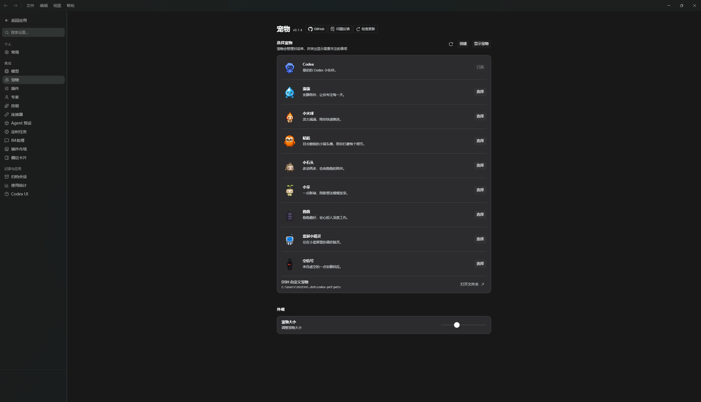</a></p>

</details>

<details>
<summary>Nossos plugins (6 capturas)</summary>

<p align="center"><em>Perfis de especialistas: filtragem, busca e ativação de papéis.</em></p>

<p align="center"><a href="assets/screenshots/preview-experts.webp">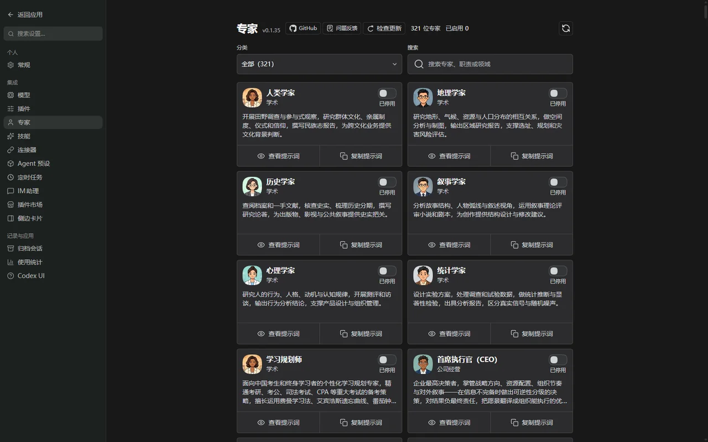</a></p>

<p align="center"><em>Gestão de habilidades: gerencie Agent Skills em todas as fontes.</em></p>

<p align="center"><a href="assets/screenshots/preview-skills.webp">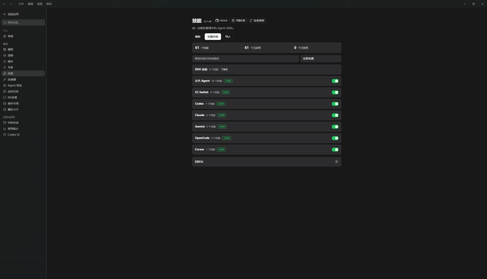</a></p>

<p align="center"><em>Automação agendada: exemplos, cronogramas e histórico de execução.</em></p>

<p align="center"><a href="assets/screenshots/preview-automation.webp">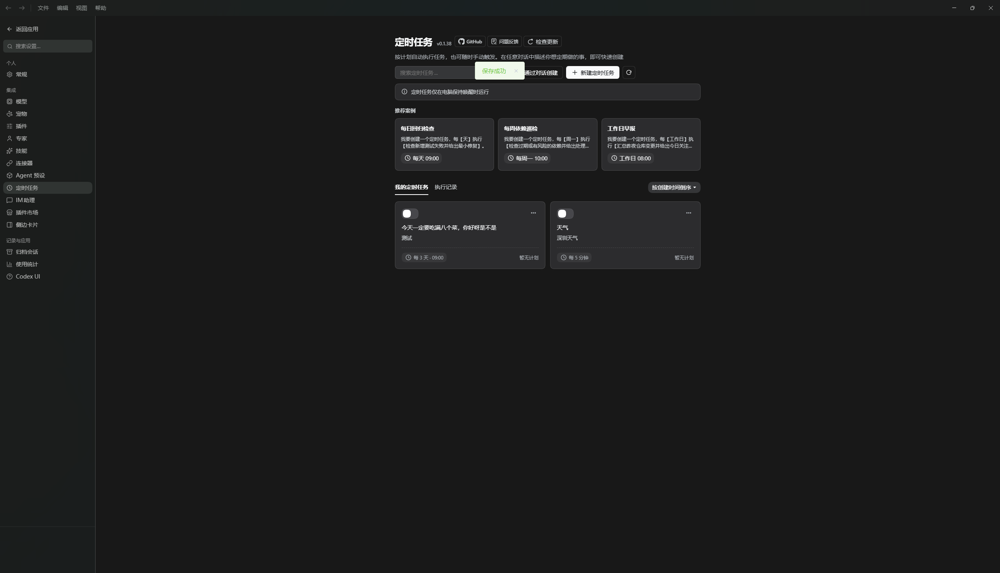</a></p>

<p align="center"><em>Assistente de mensagens (IM): canais, contas e mensagens recebidas.</em></p>

<p align="center"><a href="assets/screenshots/preview-im-connect.webp">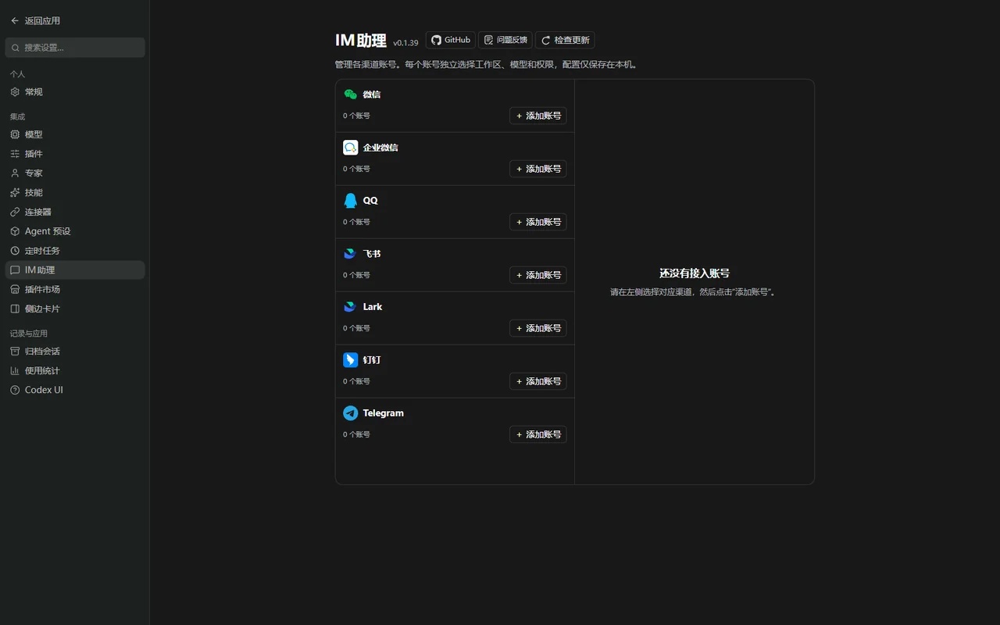</a></p>

<p align="center"><em>Conversas arquivadas: filtragem por projeto, busca e restauração.</em></p>

<p align="center"><a href="assets/screenshots/preview-archive.webp">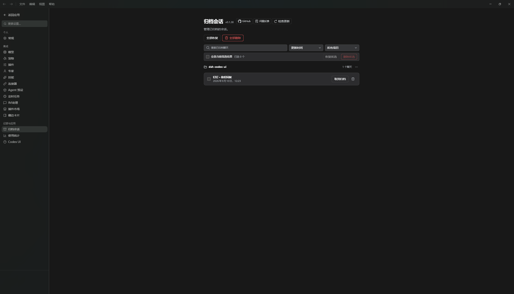</a></p>

<p align="center"><em>Configurações do Codex UI: visão geral dos recursos e status dos plugins.</em></p>

<p align="center"><a href="assets/screenshots/preview-codex-ui.webp">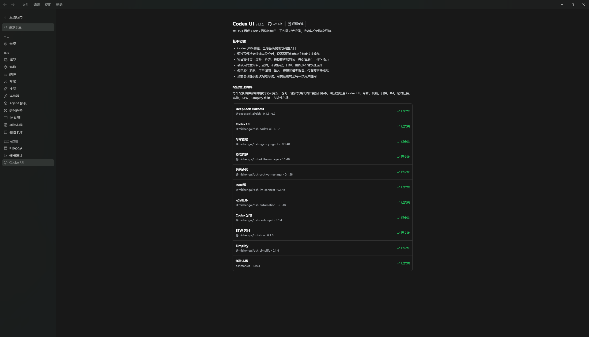</a></p>

</details>

<details>
<summary>Plugins comunitários (4 capturas)</summary>

<p align="center"><em>Configurações de contexto</em></p>

<p align="center"><a href="assets/screenshots/preview-context.webp">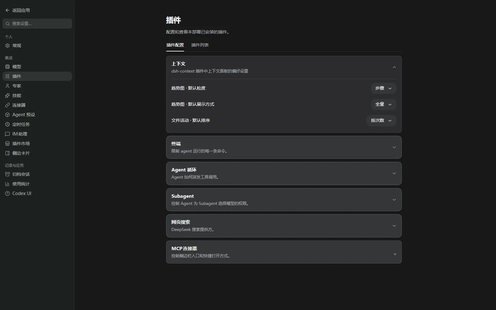</a></p>

<p align="center"><em>Configurações da barra lateral</em></p>

<p align="center"><a href="assets/screenshots/preview-sidebar.webp">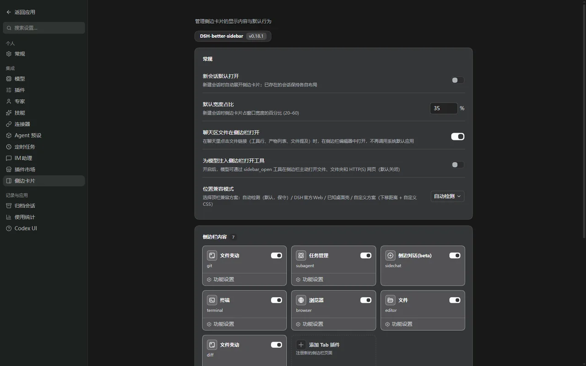</a></p>

<p align="center"><em>Mercado de extensões: descoberta e verificação de status de instalação e atualização.</em></p>

<p align="center"><a href="assets/screenshots/preview-plugin-market.webp">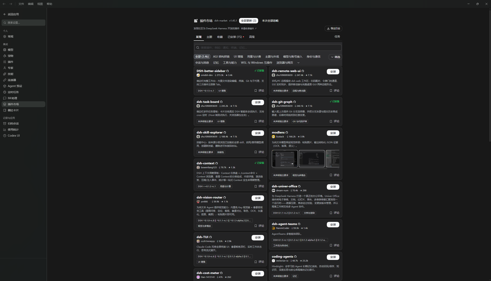</a></p>

</details>

## Plugins incluídos por padrão

O instalador inclui o runtime local necessário para executar o DSH. No primeiro início, ele prepara os plugins comunitários voltados ao desktop no perfil Web:

| Funcionalidade | Pacote |
| --- | --- |
| Interface no estilo Codex | [`@michengai/dsh-codex-ui`](https://github.com/MichengAI/dsh-codex-ui) |
| Mascote desktop e notificações | [`@michengai/dsh-codex-pet`](https://github.com/MichengAI/dsh-codex-pet) |
| Gestão de especialistas | [`@michengai/dsh-agency-agents`](https://github.com/MichengAI/dsh-agency-agents) |
| Gestão de habilidades | [`@michengai/dsh-skills-manager`](https://github.com/MichengAI/dsh-skills-manager) |
| Gestão de arquivos | [`@michengai/dsh-archive-manager`](https://github.com/MichengAI/dsh-archive-manager) |
| Assistente de mensagens | [`@michengai/dsh-im-connect`](https://github.com/MichengAI/dsh-im-connect) |
| Automação de tarefas | [`@michengai/dsh-automation`](https://github.com/MichengAI/dsh-automation) |
| Barra lateral expansível | [`dsh-better-sidebar`](https://github.com/omdsh-dev/DSH-better-sidebar) |
| Perguntas secundárias rápidas | [`@michengai/dsh-btw`](https://github.com/MichengAI/dsh-btw) |
| Simplificação de código Git | [`@michengai/dsh-simplify`](https://github.com/MichengAI/dsh-simplify) |
| Diagnóstico e recuperação de falhas | [`@michengai/dsh-pua`](https://github.com/MichengAI/dsh-pua) |
| Revisão de código independente | [`@michengai/dsh-code-review`](https://github.com/MichengAI/dsh-code-review) |
| Mercado de extensões | [`dshmarket`](https://www.npmjs.com/package/dshmarket) |

Posteriormente é possível instalar plugins adicionais através do mercado. O aplicativo de desktop mantém seu próprio runtime separado dos plugins comunitários do perfil.

## Ecossistema de produtos DSH

Para uma bancada desktop completa, baixe o [DSH Codex Desktop](https://github.com/MichengAI/dsh-codex-desktop/releases). Instalações existentes do [DeepSeek Harness](https://github.com/deepseek-ai/deepseek-harness) podem adicionar plugins individualmente:

| Plugin | O que você pode fazer |
| --- | --- |
| [Codex UI](https://github.com/MichengAI/dsh-codex-ui) | Organizar projetos e conversas, pesquisar tarefas e navegar no histórico |
| [Agency Agents](https://github.com/MichengAI/dsh-agency-agents) | Escolher e convocar especialistas para sua tarefa |
| [Skills Manager](https://github.com/MichengAI/dsh-skills-manager) | Descobrir, ativar, criar e importar habilidades locais |
| [Archive Manager](https://github.com/MichengAI/dsh-archive-manager) | Pesquisar, restaurar ou limpar conversas arquivadas |
| [IM Connect](https://github.com/MichengAI/dsh-im-connect) | Enviar tarefas e receber respostas através de mensageiros |
| [Automation](https://github.com/MichengAI/dsh-automation) | Agendar tarefas e acompanhar o histórico de execuções |
| [BTW](https://github.com/MichengAI/dsh-btw) | Fazer perguntas secundárias sem interromper a tarefa principal |
| [Simplify](https://github.com/MichengAI/dsh-simplify) | Otimizar código no escopo das suas alterações Git |
| [PUA](https://github.com/MichengAI/dsh-pua) | Orientar o Agent a tentar novas abordagens após erros e verificar o resultado |
| [Code Review](https://github.com/MichengAI/dsh-code-review) | Solicitar análise independente de código via `/review` |
| [Codex Pet](https://github.com/MichengAI/dsh-codex-pet) | Notificações de tarefas e respostas a aprovações através de mascote |

O aplicativo também integra o [DSH Better Sidebar](https://github.com/omdsh-dev/DSH-better-sidebar) e o [App Market](https://www.npmjs.com/package/dshmarket).

## Atualizações e recuperação

- **Atualizações do desktop**: Verificadas automaticamente após a inicialização. Em Configurações → Atualizações você pode habilitar o download automático. A instalação sempre requer confirmação.
- **Recarregamento do DSH**: Disponível no menu da bandeja para reiniciar o serviço local sem reinstalar o aplicativo.
- **Atualização de plugins**: Gerenciadas nas configurações do DSH e no mercado de extensões.
- **Modo de recuperação**: Isola com segurança plugins problemáticos se impedirem o carregamento normal.

## Requisitos do sistema (System requirements)

| Item | Requisito |
| --- | --- |
| Sistema operacional | Windows 10/11, macOS ou Linux |
| Arquitetura | Windows x64, macOS arm64/x64 ou Linux x64/arm64 |
| Node.js | Não necessário para usuários finais (embutido no app) |
| Rede | Necessária apenas para provedores de modelos e downloads de plugins |

## Privacidade e segurança (Privacy and security)

- Configurações do DSH, sessões e credenciais permanecem no diretório do usuário. A desinstalação não os apaga.
- O launcher aceita apenas endereços HTTP locais validados `127.0.0.1`.
- Links externos abrem no navegador padrão do sistema.
- O Electron utiliza isolamento de contexto e sandbox sem integração Node.js nas páginas do DSH.
- Os modelos e ferramentas configurados podem realizar suas próprias requisições de rede. Verifique suas políticas de privacidade.

## Desenvolvimento (Development)

Documentação de transição: [Resumo da arquitetura base](docs/00-交接入口/05-技术架构基线.md) · [Arquitetura base do launcher desktop](docs/03-技术架构/00-桌面启动器架构基线.md).

Para desenvolvimento são necessários Windows, Node.js `24.21.0` e pnpm `11.26.0`.

```powershell
[Console]::OutputEncoding = [System.Text.Encoding]::UTF8
$OutputEncoding = [System.Text.Encoding]::UTF8
pnpm install --frozen-lockfile
pnpm test
pnpm run dist
```

## Licença (License)

Este projeto está licenciado sob a [Licença Apache 2.0](LICENSE).
